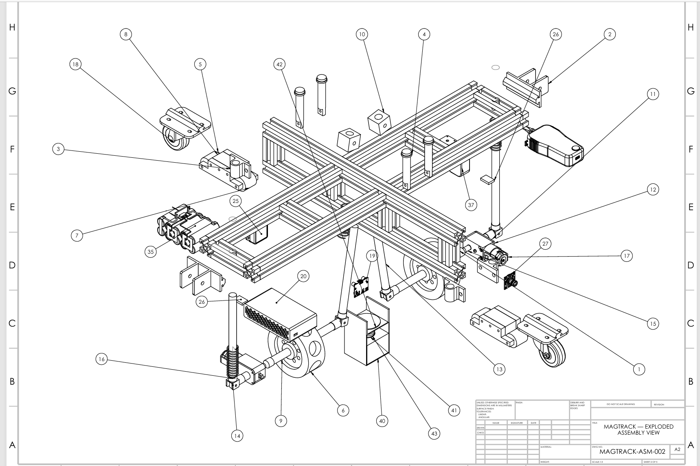

# MAGTRACK: Magnetic Wall-Climbing Robot for Pipeline Inspection

Capstone Design Project (CDP I and II), Higher Colleges of Technology.
Built by a 6-person team. This repository documents my individual contributions.

## The problem
Inspecting the outside wall of large-diameter pipelines for corrosion can mean
sending people to work at height. MAGTRACK is a robot that climbs the pipe itself
and measures wall thickness autonomously with an ultrasonic probe (pipe sizes DN1000 and above).

## How it works
- **Magnetic adhesion:** NdFeB drive magnets hold the robot against the steel wall
- **Tracked drive:** geared 24 V motors through BTS7960 drivers, with differential steering
- **Passive five-bar linkages** let the drive units follow the pipe curvature
- **Inspection payload:** 5 MHz ultrasonic thickness probe with couplant dosing
- **Electronics:** Arduino Mega controller, about 24 V battery (22.2 to 25.2 V)

| Design requirement | Target |
|---|---|
| Magnetic adhesion safety factor | at least 3.0 on vertical surfaces |
| Total robot mass | 7.5 kg or less (SolidWorks model: 5.88 kg) |
| Operating time | at least 100 min |
| Thickness accuracy | ±0.1 mm |

## CDP I: my contribution (mechanical design)
I led the mechanical design of the climbing platform.

- Designed the passive five-bar adaptive linkage
- Modeled the full SolidWorks assembly (45+ components)
- Validated magnetic adhesion with an FEM simulation:
  730 N available against about 252 N required

## CDP II: new subsystems (each in its own folder)

| Subsystem | My role | Status |
|---|---|---|
| [Scanning and dosing subsystem](scanning-dosing/) | Sole designer | Design Rev 2 complete; tests planned |
| [Power and actuation PCB (Board 1)](pcb-power-actuation/) | Designed Board 1 | Layout finalized |

CDP II continues with fabrication and hardware testing.
Results marked "planned" are test protocols that have not been run yet.

## Credits
Team: [names]. Supervisor: [name].
The logic board (Board 2) was designed by [teammate] and is not included here.
