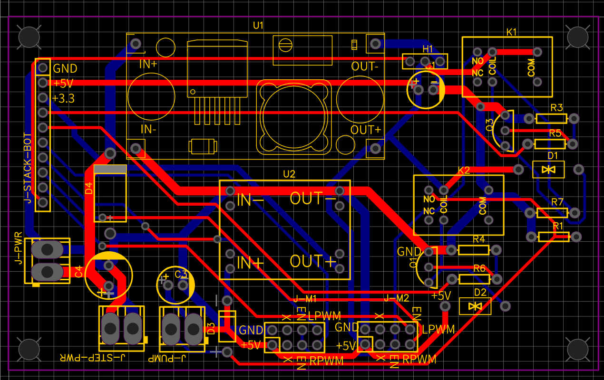

# Power & Actuation PCB (Board 1)

Power distribution, safety interlock and actuation interface for MAGTRACK.
Designed in EasyEDA for campus CNC milling.

## What it does
- 24 V input with 3 A fuse, TVS diode and bulk capacitor
- 5 V (LM2596) and 3.3 V (MP1584EN) rails
- K1 relay: hardware motor-enable gate that opens on reset or power loss
- K2 relay: couplant pump switch, with flyback diodes
- Servo header with a local 470 µF capacitor
- 10-pin stack connector to the logic board

## Files
- [Design summary (PDF)](MAGTRACK_Board1_Power_Actuation_PCB.pdf)
- Schematic and layout images in `Images/`

## Status
Layout finalized. Fabrication and test results will be added.
